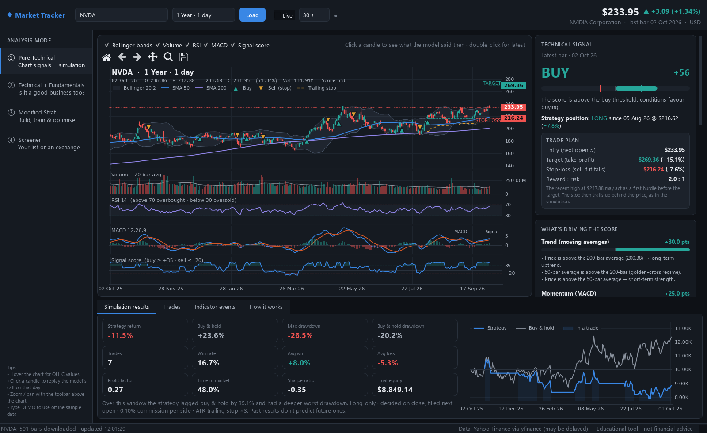
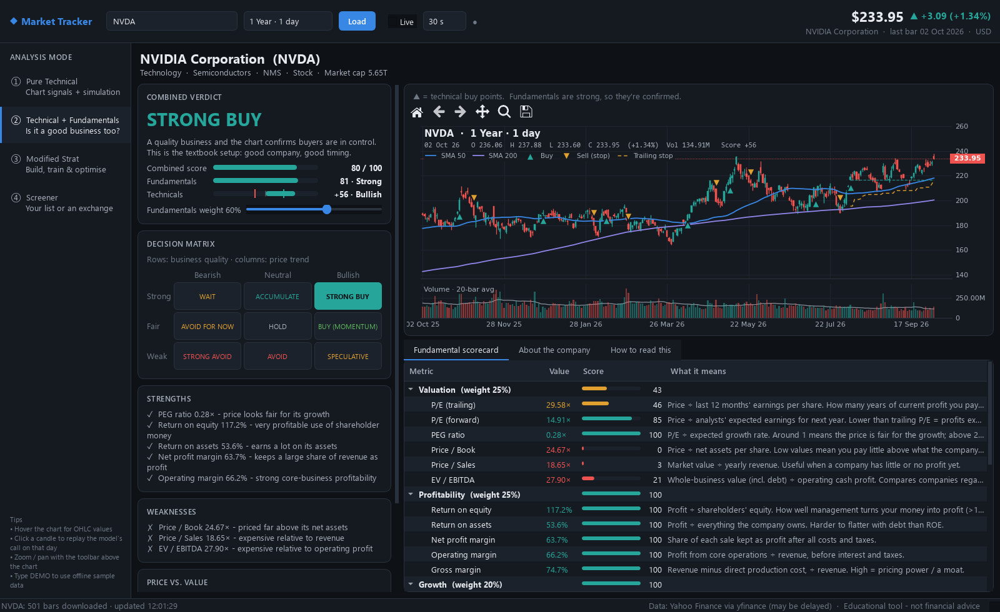
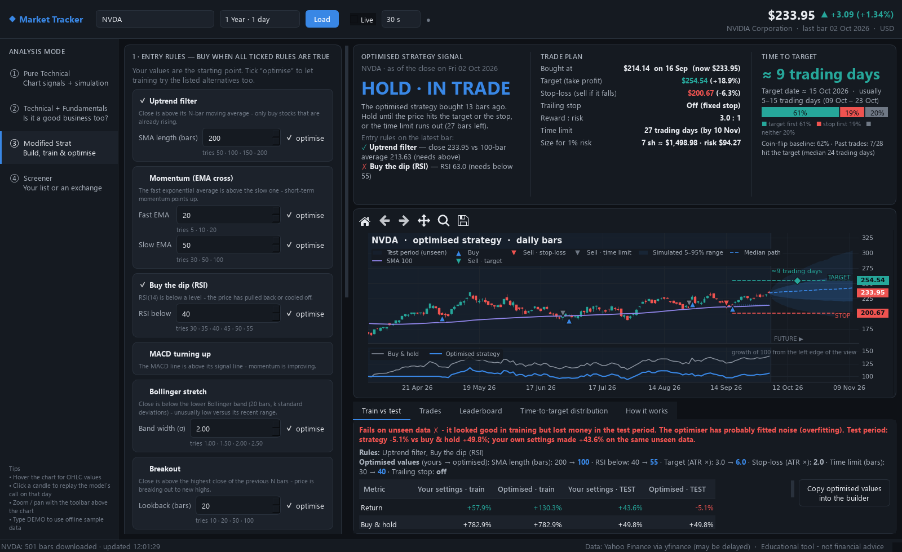
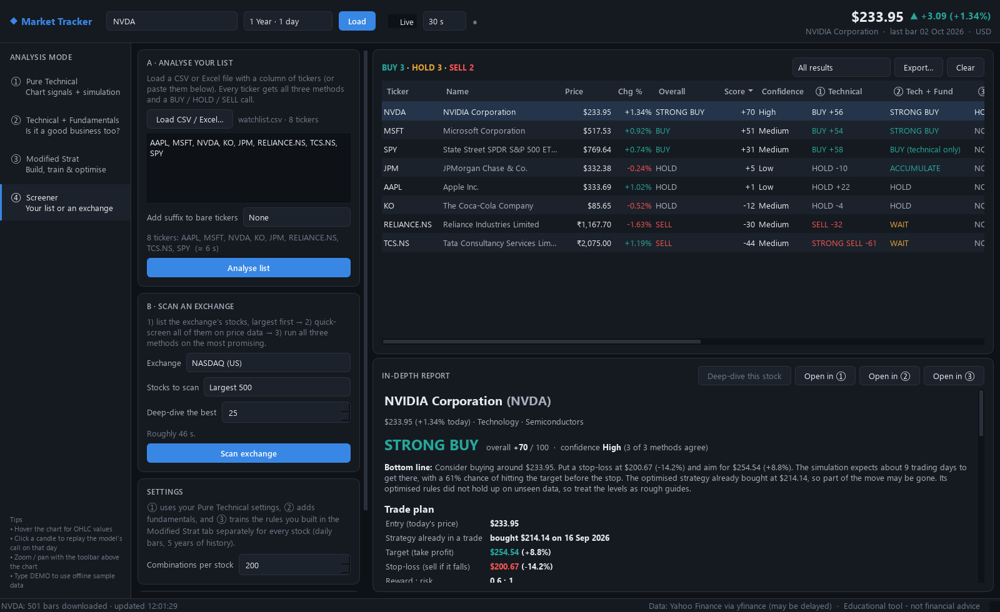

# Market Tracker


A desktop app for **learning how markets are analysed**. It tracks live stock prices as candlesticks,
finds technical buy/sell points with a target and stop-loss, checks whether the business behind the stock
is any good, lets you build and train your own strategy, and screens whole exchanges for opportunities.
Every number comes with a plain-English explanation.



> **Educational tool only - not financial advice.** Nothing here places trades. Prices come from Yahoo
> Finance and may be delayed. Past results do not predict future ones.

## Contents

- [Quick start](#quick-start)
- [The four modes](#the-four-modes)
- [How the technical model works](#how-the-technical-model-works)
- [Tests](#tests)
- [Project layout](#project-layout)
- [Troubleshooting](#troubleshooting)
- [Data and disclaimer](#data-and-disclaimer)
- [License](#license)

## Quick start

Requires **Python 3.10 or newer**. Clone or download this repository, then run these from its folder.

**Windows**

```bash
python -m venv .venv
.venv\Scripts\python -m pip install -r requirements.txt
.venv\Scripts\python main.py
```

After the first setup you can also double-click `run.bat`.

**macOS / Linux**

```bash
python3 -m venv .venv
.venv/bin/python -m pip install -r requirements.txt
.venv/bin/python main.py
```

Pass a symbol to open it directly: `python main.py TSLA`.

Symbols use Yahoo format:

| Kind | Examples |
|---|---|
| US stocks and ETFs | `AAPL`, `MSFT`, `SPY` |
| India | `RELIANCE.NS` (NSE), `TCS.BO` (BSE) |
| Indices | `^GSPC`, `^NSEI` |
| Crypto | `BTC-USD` |
| Offline sample data | `DEMO` |

The app is developed and tested on Windows 11. PySide6 and matplotlib are cross-platform, so macOS and
Linux should work, but they are untested.

## The four modes

### ① Pure Technical

Only price and volume are used.

* **Chart**: candlesticks with 50/200 moving averages, Bollinger bands, volume, RSI, MACD and the
  model's *signal score*. ▲ marks simulated buys, ▼ marks sells (red = sell signal, amber = stop-loss).
* **Technical signal**: STRONG BUY … STRONG SELL for the latest bar, with a plain-English breakdown of
  what each indicator is saying and how many points it adds or subtracts.
* **Trade plan on a buy**: when the call is BUY or STRONG BUY, the card and chart show a **target**
  and a **stop-loss**. The stop sits 3 ATRs below the close; the target is 2× that risk above it
  (a 2 : 1 reward-to-risk ratio). Both multiples are adjustable.
* **Click any candle** to see what the model said on that day, using only data available then.
* **Simulation**: trades the strategy over the visible window and compares it with buy & hold: return,
  drawdown, win rate, profit factor, Sharpe, equity curve, and a trade log.
* **Strategy settings**: change the averages, thresholds, stop distance and indicator weights, then re-run.

### ② Technical + Fundamentals

Adds *is this a good business at a fair price?*



* **Scorecard**: 21 metrics across valuation, profitability, growth, financial health and analyst
  view, each scored 0-100 with an explanation of what it means.
* **Decision matrix**: fundamentals (Strong / Fair / Weak) × technicals (Bullish / Neutral / Bearish),
  giving verdicts like "STRONG BUY", "WAIT - good company, bad timing" or "SPECULATIVE".
* **Price vs. value**: Graham number, analyst targets, 52-week range.
* ETFs, indices and crypto have no company fundamentals, so this mode falls back to the technical view.

### ③ Modified Strat

Build your own strategy, train it on history, and check it honestly.



* **Build**: tick entry rules (all must be true to buy): uptrend filter, EMA momentum, RSI dip, MACD,
  Bollinger stretch, breakout, volume confirmation. Then set the exit plan: target and stop-loss in ATRs,
  optional trailing stop, and a time limit.
* **Train**: every parameter marked *optimise* is searched (all combinations, or a random sample of
  them) on the **older** part of daily history only. Combinations are ranked by Sharpe, return,
  return ÷ drawdown, profit factor or win rate.
* **Test**: the winner is replayed on the most recent part it never saw. A verdict says whether it
  holds up or was **overfitted**, and compares it with your own settings on the same unseen data.
* **Signal**: BUY / HOLD (already in a trade) / WAIT / NO BUY, with each rule's ✓/✗ on the latest bar.
  The trade plan shows the target price, stop-loss price, trailing-stop behaviour, reward:risk, time limit
  and a position size that risks 1% of a $10,000 account.
* **Time to target** is estimated three ways:
  1. 4,000 simulated futures built from the stock's real past daily moves: median days, likely range,
     and the chance of hitting the target vs. the stop first.
  2. A coin-flip baseline.
  3. How the strategy's own past trades ended.
* In Live mode the trained rules are re-applied to the latest prices without re-training.

### ④ Screener

Run all three methods over many stocks at once.



* **Analyse your list**: load a CSV or Excel file (the ticker column is found automatically, e.g. a column
  headed *Symbol* or *Ticker*), or paste tickers. For Indian stocks without a suffix, pick *.NS* or *.BO*.
  Examples are in [`examples/`](examples). Every ticker gets the full treatment and an overall
  **BUY / HOLD / SELL**.
* **Scan an exchange**: NASDAQ, NYSE, NYSE American, NSE, BSE, London, Toronto, XETRA, Paris, Tokyo,
  Hong Kong or ASX. It works like a funnel:
  1. List the exchange's stocks, largest first.
  2. Quick-screen all of them on price data (Pure Technical + your ③ rules).
  3. Deep-dive the best N with all three methods, including a strategy optimised for each stock.

  Rough speeds: the largest 500 NASDAQ stocks in ~30 s; a whole exchange in a few minutes. Stocks with
  under ~15 months of history are skipped.
* **Overall call**: each method votes from −1 to +1, weighted ① 30% · ② 35% · ③ 35%.
  * BUY ≥ +30, SELL ≤ −25, otherwise HOLD.
  * A Modified Strat buy counts for less when its rules failed on unseen data.
  * Confidence reflects how many methods agree.
* **In-depth report** for each stock:
  * a bottom-line recommendation
  * a trade plan (entry, target, stop-loss, reward:risk, time to target and its odds, position size)
  * each method's reasoning
  * how the votes were combined

  Double-click a row, or use *Open in ①/②/③*, to jump to that stock in the other screens.
* **Export** the results to Excel or CSV.

## How the technical model works

Each indicator votes between −1 and +1:

| Component | Idea | Default weight |
|---|---|---|
| Trend | price vs. 50/200-bar averages | 30 |
| MACD | momentum improving or fading | 25 |
| RSI | momentum in the normal range, contrarian above 70 / below 30 | 20 |
| Bollinger | contrarian when price is stretched outside the bands | 15 |
| Volume | heavy volume confirms the bar's direction | 10 |

The weighted votes form a score from −100 to +100. The simulation **buys** when the score crosses up
through +35 and **sells** when it drops to −20, or when a 3×ATR trailing stop is hit. Decisions use a
bar's close and are filled at the **next bar's open**, so it never trades on prices it couldn't have
known.

Expect the simulation to lag buy & hold in strong bull markets. Its benefit usually shows up as smaller
drawdowns. Try the same settings on many symbols before trusting any of them.

## Tests

```bash
python -m unittest discover tests
```

The suite runs offline (it uses the built-in `DEMO` data) and needs no display. It covers the
indicators, the simulations, the optimiser, the forecast and the screener. Two tests guard against the
classic backtesting mistakes:

* **No look-ahead**: scores up to a given day are identical whether or not later days exist.
* **No test-set leakage**: scrambling the unseen test period never changes which parameters win in training.

GitHub Actions runs the same suite on every push (see [`.github/workflows/tests.yml`](.github/workflows/tests.yml)).

## Project layout

```
main.py                     entry point
run.bat                     Windows launcher
tracker/
  data.py                   Yahoo Finance download, timeframes, DEMO data
  net.py                    HTTPS sessions (also trusts the Windows certificate store)
  indicators.py             SMA, EMA, RSI, MACD, Bollinger, ATR
  strategy.py               indicator votes -> signal score, explanations, events
  backtest.py               bar-by-bar trading simulation
  analysis.py               glue + per-bar snapshots (score, target, stop)
  fundamentals.py           fundamental scorecard
  combined.py               decision matrix for mode ②
  custom_strategy.py        mode ③: rule builder, simulator, optimiser, train/test split
  forecast.py               Monte Carlo time-to-target estimate
  screener.py               mode ④: ticker files, exchange scans, combined BUY/HOLD/SELL
  gui/                      PySide6 + matplotlib interface
examples/                   sample watchlists (CSV and Excel) for the screener
docs/screenshots/           images used in this README
tests/                      unit tests
```

## Troubleshooting

* **"certificate verify failed"**: some antivirus suites (e.g. Norton) and corporate proxies inspect
  HTTPS traffic. The app already merges the Windows certificate store into its CA bundle. If `pip` fails
  the same way inside a fresh venv, upgrade pip first:
  `python -m pip install --cert "C:\ProgramData\Norton\Antivirus\wscert.pem" --upgrade pip`.
* **Rate-limited**: Yahoo throttles heavy use. Choose a slower live refresh (1-5 min).
* **A symbol isn't found**: check it on [finance.yahoo.com](https://finance.yahoo.com) - non-US stocks need
  an exchange suffix such as `.NS`, `.L` or `.TO`.

## Data and disclaimer

Market data is fetched from Yahoo Finance through [yfinance](https://github.com/ranaroussi/yfinance) and
Yahoo's public chart endpoint. This project is not affiliated with or endorsed by Yahoo. The data is
intended for personal, educational use; check Yahoo's terms before using it for anything else.

The signals, targets, stops and time estimates are simplified models built from past prices. They are
often wrong, and the app shows how often. Do not use them to make real investment decisions.

## License

[MIT](LICENSE)
